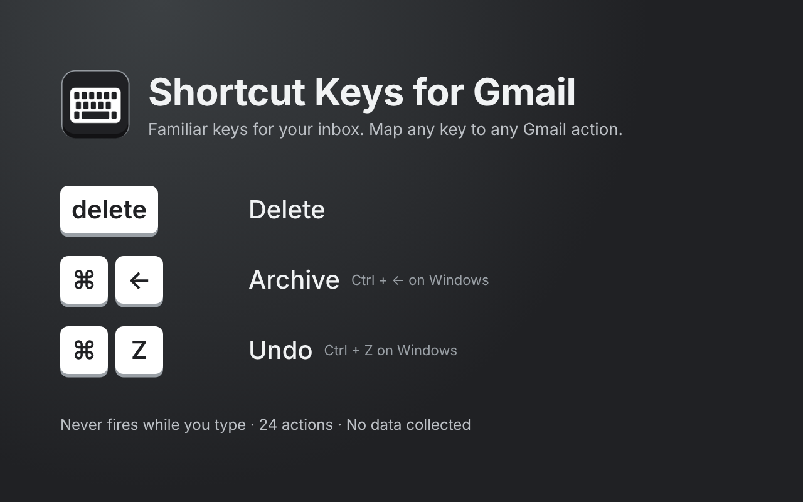

### `My Shortcut Keys for Gmail`

My Shortcut Keys for Gmail brings familiar keys to your inbox. Press Delete to delete, ⌘← to archive and ⌘Z to undo, or map any key to any Gmail action.

  <a href="https://chromewebstore.google.com/detail/my-shortcut-keys-for-gmai/npcmjpdpogdfnlhagpoclfkhfjbpgmob">
    Add to Chrome
  </a>
  •
  <a href="docs/guide.md">
    Documentation
  </a>
  •
  <a href="PRIVACY.md">
    Privacy
  </a>

 

### What it does

- **Familiar keys out of the box.** `delete` (Backspace) deletes the selected or open email, `⌘` `←` archives it and `⌘` `Z` undoes the last action. On Windows and Linux, use `Ctrl` instead of `⌘`.
- **Map any key to any action.** Pick from 24 actions on the settings page: archive, delete, undo, read/unread, spam, star, important, mute, snooze, move, label, reply, reply all, forward, compose, newer/older, back to list, search, and go to Inbox, Sent, Starred or Drafts.
- **Stays out of your way while you type.** Shortcuts never fire in compose, inline replies, To/Cc fields, the search box or any text field, nor during IME composition such as Japanese input. Holding a key down does not repeat the action.
- **Settings follow you.** Your key map syncs through your browser account.

### Install

Add it from the [Chrome Web Store](https://chromewebstore.google.com/detail/my-shortcut-keys-for-gmai/npcmjpdpogdfnlhagpoclfkhfjbpgmob). It works in Chrome, Edge, Brave and other Chromium browsers. The Firefox Add-ons listing is coming soon; until then, Firefox 128 or later can load it from source. After installing, click the toolbar icon to open the settings page. Some actions need **Gmail Settings → See all settings → General → Keyboard shortcuts on** (see the [Guide](docs/guide.md#how-actions-run)).

### Contributing

Bugs and ideas are welcome in [GitHub Issues](https://github.com/semicolonconsulting/mygmailshortcutkeys/issues). To build the extension yourself or run the tests, see [Build from source](docs/building.md).

### Privacy

My Shortcut Keys for Gmail collects no data. See [Privacy](PRIVACY.md).

### License

MIT. See [LICENSE](LICENSE).
